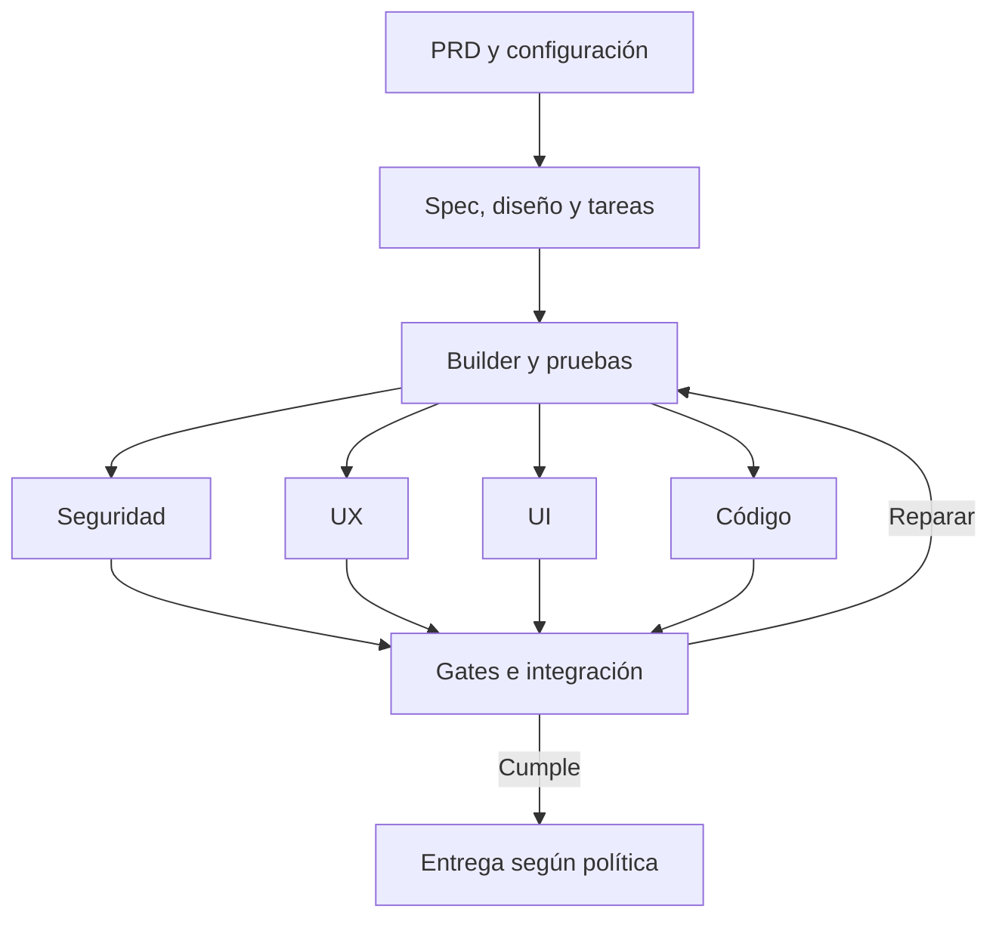

# Extracción y estudio del vídeo

Fuente: vídeo adjunto por Gregory, 17:21 aproximadamente. Tiempos orientativos; la transcripción automática adjunta permite localizar el discurso. Este documento resume el contenido; el audio reconocido completo está en `evidence/`.

## Tesis del autor

Chatear continuamente con agentes mantiene al humano como intermediario de cada tarea. La propuesta es convertir el trabajo en un proceso con entrada, etapas y salida, que combine código, agentes y participación humana cuando corresponda. La factory necesita ser repetible, auditable y conservar el contexto.

El autor presenta su experiencia y recomendaciones; no muestra una implementación completa verificable. No tomar sus afirmaciones sobre todo el sector, mejora de productividad, modelos o empresas como resultados demostrados.

## Mapa temporal detallado

| Tramo aproximado | Contenido del vídeo | Aplicación a la factory de Gregory |
|---|---|---|
| 00:00–01:38 | El humano sigue siendo cuello de botella aunque use varias ventanas; memoria, skills y procesos permiten delegar más | Un punto de entrada y un director, no coordinación manual constante |
| 01:38–02:55 | Factory como proceso repetible y auditable; analogía con fabricación y cajas conectadas; definir qué, cómo, resultado y revisión | Contrato de entrada/salida y evidencia por etapa |
| 02:55–04:00 | Tres clases de paso: código, agente y humano; importancia de combinarlos | Motor determinista, juicio del modelo y autorizaciones configuradas |
| 04:00–05:32 | Brain/contexto persistente; recordar decisiones como PostgreSQL frente a MySQL y consultar antes de actuar | PRD/ADR/versiones como fuente de verdad y contexto por tarea |
| 05:32–06:49 | Origen en errores de una app con Sentry; reflexión sobre n8n; entrada unificada de errores, issues GitHub y tareas | Intake adaptable; empezar con PRD y añadir incidencias después |
| 06:49–07:33 | Spec writer con Opus y referencias a SDD/FTD; consulta brain antes de escribir la spec para evitar duplicaciones y errores de arquitectura | Requisitos verificables y planificación consciente del código existente |
| 07:33–08:14 | Builder con Opus crea worktree/rama, implementa la spec y usa TDD por tarea | Workspace aislado, pruebas relevantes y evidencia red/green cuando aplique |
| 08:14–08:47 | Cuatro subagentes con contexto limpio para seguridad, UX, UI y consistencia de código | Revisiones especializadas separadas del constructor |
| 08:47–09:07 | Seguridad con modelo que denomina Sol y licencia Codex; busca evitar sesgo del constructor | Proveedor alternativo opcional; evidencia y pruebas siguen siendo obligatorias |
| 09:07–09:29 | UX con Sol: flujo, número de pasos y adecuación al usuario objetivo descrito en brain | Revisión por tareas y recuperación de errores |
| 09:29–09:52 | UI con Astra; el autor vincula su elección a computer use y entrenamiento | Revisión visual con navegador; no asumir nombres/capacidades de API |
| 09:52–10:17 | Código con Sonnet: arquitectura, forma de escribir, comentarios y convenciones en brain | Revisión de contratos, tipos y mantenimiento |
| 10:17–10:50 | Approver con Opus recoge feedback; si hay problemas vuelve al builder y repite | Reparación con hallazgos trazables y límite de intentos |
| 10:50–12:35 | Paso posterior decide ruta automática o PR con humano; ejemplo color de botón vs backend/core/BD; hooks/código para bloquear | Política de riesgo aplicada fuera de la mera decisión del LLM |
| 12:35–13:16 | Tareas en paralelo, identificador propio, ramas y tests; declara corrección automática de errores en su sistema | IDs, DAG, leases, aislamiento e integración verificada |
| 13:16–13:52 | Entrada desde Slack para marketing/ventas, con identidad del solicitante; landing, textos y cambios similares | Futuras integraciones con permisos; no son requisito del MVP |
| 13:52–15:24 | Extensión a content factory; ejemplo de edición de contenido, silencios, repeticiones, diseño, transiciones y miniaturas; él revisa y sube el vídeo manualmente | Mismo patrón de proceso, pero mantener fuera del primer producto software |
| 15:24–16:16 | Propone automatizar tareas recurrentes con entrada/salida; referencias a equipos/empresas | Priorizar flujos repetidos y medir resultados reales |
| 16:16–17:21 | Crear la factory no es trivial; debe ser auditable, seguible y arreglable; presenta RSC Factory y anuncia código abierto futuro | No hay código completo en el archivo; construir implementación propia verificable |

## Flujo que muestra

Entrada de trabajo → spec writer → builder → cuatro revisores → approver → clasificación de riesgo → integración/producción o PR con humano. El brain se consulta a lo largo del proceso. Si la revisión es negativa, vuelve al builder.

| Pieza mostrada | Modelo/nombre mostrado | Función descrita |
|---|---|---|
| Spec writer | Opus | Escribir spec apoyándose en brain |
| Builder | Opus | Rama/worktree, implementación y TDD |
| Seguridad | Sol | Revisar seguridad usando otra familia |
| UX | Sol | Revisar recorrido y adecuación al usuario |
| UI | Astra | Revisar interfaz, con énfasis en computer use |
| Código | Sonnet | Comprobar convenciones/arquitectura |
| Approver | Opus | Consolidar feedback y devolver reparaciones |
| Clasificador de riesgo | El autor recomienda modelo de alta capacidad | Decidir si requiere intervención humana, con bloqueos por código/hooks |
| Content factory | Menciona Opus 5.5 | Su ejemplo de edición de contenido |

Estos nombres se transcriben como aparecen; no son una configuración de proveedores validada. SDD/FTD se mencionan pero no se entregan sus skills ni una definición suficiente para recrearlas exactamente. No inventamos la expansión de FTD.

## Qué información concreta no aporta

No aporta repositorio verificable, contratos de datos, prompts íntegros, scheduler, almacenamiento de estado, estrategia de colas, control de duplicados, límites de reparación, presupuesto, sandbox, manejo de credenciales, proceso de merge concurrente, pruebas del motor ni rollback detallado. Tampoco demuestra un producto completo creado desde un PRD vacío de contexto.

Por tanto, copiar solamente los nombres de sus agentes no reproduce el sistema. Los documentos de arquitectura y ejecución de este paquete son el diseño necesario para pasar de su explicación a una implementación.

## Qué conservar y qué ajustar

Conservar: brain, especificación antes de construir, worktree/rama, pruebas, revisiones especializadas, feedback, auditoría y política de riesgo.

Ajustar: no dar al approver poder para saltarse tests; no equiparar contexto limpio a garantía de independencia; no publicar automáticamente solo porque un modelo diga «cambio pequeño»; no introducir todos los proveedores antes de demostrar el flujo básico.

Añadir para Gregory: PRD como entrada, fase de arquitectura/diseño de producto, plantillas por tipo de app, estado durable, contratos Zod, trazabilidad requisito → tarea → prueba, límites de coste, reanudación, aislamiento, integración comprobada y una demo que pruebe el sistema entero.

## Glosario sencillo

- **PRD:** qué problema resuelve el producto y cómo sabremos que lo resuelve.
- **Spec:** instrucciones verificables para una parte concreta del trabajo.
- **Brain:** decisiones y contexto persistentes del proyecto.
- **Builder:** agente que implementa.
- **Worktree:** carpeta de trabajo Git asociada a una rama; no es un sandbox de seguridad.
- **TDD:** escribir una prueba que falla, implementar para que pase y refactorizar.
- **Gate:** condición que debe cumplirse para avanzar.
- **ADR:** documento breve de una decisión arquitectónica y su motivo.
- **DAG:** tareas con dependencias sin ciclos.
- **Approver:** rol que consolida revisiones; en nuestra propuesta recomienda y el motor verifica.
- **Harness/arnés:** entorno y controles que permiten que el agente trabaje de manera consistente.

## Nuestra ampliación del flujo

El brain y el registro durable alimentan todas las fases. La publicación es un resultado posible según configuración; la primera demostración será una entrega local comprobable.
